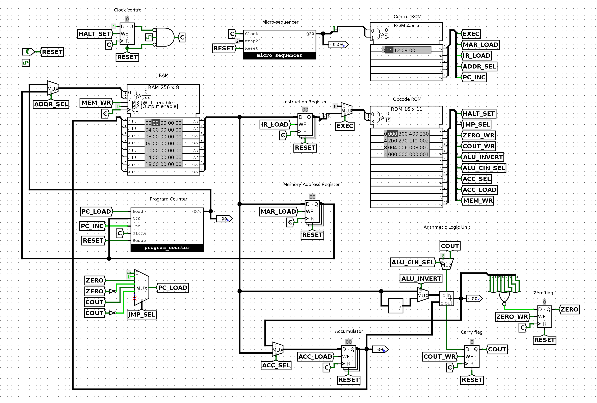

# 8-bit-computer

An 8-bit Von Neumann computer built in Logisim-evolution, inspired by **Code: The Hidden Language of Computer Hardware and Software** by Charles Petzold.



## Usage

### Execution Controls

The computer uses Logisim-evolution's clock component.

Activating the `RESET` input pin stops clock propagation and resets all registers to zero, preserving RAM contents. Releasing `RESET` allows execution to resume from the initial state.

### Instruction Set

Each instruction consists of two consecutive bytes: the opcode followed by an 8-bit memory address.

| Opcode | Instruction    | Description                                                                                  |
| ------ | -------------- | -------------------------------------------------------------------------------------------- |
| `01`   | `LOAD [addr]`  | Loads the value at the specified address into the accumulator.                               |
| `02`   | `STORE [addr]` | Stores the accumulator at the specified address.                                             |
| `03`   | `ADD [addr]`   | Adds the value at the specified address to the accumulator.                                  |
| `04`   | `ADC [addr]`   | Adds the value at the specified address and the carry flag to the accumulator.               |
| `05`   | `SUB [addr]`   | Subtracts the value at the specified address from the accumulator.                           |
| `06`   | `SBC [addr]`   | Subtracts the value at the specified address, propagating the previous carry/no-borrow flag. |
| `07`   | `JMP [addr]`   | Unconditionally jumps to the specified address.                                              |
| `08`   | `JZ [addr]`    | Jumps if the zero flag is set.                                                               |
| `09`   | `JNZ [addr]`   | Jumps if the zero flag is clear.                                                             |
| `0A`   | `JC [addr]`    | Jumps if the carry flag is set.                                                              |
| `0B`   | `JNC [addr]`   | Jumps if the carry flag is clear.                                                            |
| `0F`   | `HALT`         | Halts CPU execution until RESET.                                                             |

Only the arithmetic instructions update the zero and carry flags.

### Loading Programs

The CPU has a 256 × 8-bit RAM shared by instructions and data. Each instruction occupies two bytes: its opcode and its address operand. The address space ranges from `00` to `FF`.

Programs are loaded into RAM using Logisim-evolution's memory image functionality.

Memory images use the `v2.0 raw` format, with hexadecimal byte values arranged sequentially from address `00`. For example:

```text
v2.0 raw
01 20
04 21
02 22
0F 00
```

To load a program:

1. Browse the `software/` directory and choose an example.
2. Read its `program.txt` file for the memory layout, instructions, and usage notes.
3. Right-click the RAM component in Logisim-evolution, select `Load Image...`, and choose the example's `memory.hex` file.
4. If the program requires input values, enter them at the specified RAM addresses using the Logisim GUI.
5. Run the CPU and inspect the result at the output addresses documented in `program.txt`.

## Internal Architecture

RAM and ROM reads are asynchronous: their outputs update when their address inputs change, without waiting for a clock edge. Register updates and other state changes are committed on active clock edges.

Instruction control is divided between two ROMs. The micro-sequencer ROM manages the three-step instruction cycle and generates the control signals required for fetching and execution. The opcode ROM decodes the current instruction and generates the signals specific to that operation.

### Micro-sequencer

The micro-sequencer controls the three execution steps of every instruction through a dedicated control ROM.

It produces a 5-bit control word, with the following bit assignments:

| Bit | Signal     | Description                                          |
| --- | ---------- | ---------------------------------------------------- |
| 0   | `EXEC`     | Enables instruction decoding through the opcode ROM. |
| 1   | `MAR_LOAD` | Loads the data bus into the Memory Address Register. |
| 2   | `IR_LOAD`  | Loads the data bus into the Instruction Register.    |
| 3   | `ADDR_SEL` | Selects the RAM address source: `0` = PC, `1` = MAR. |
| 4   | `PC_INC`   | Increments the Program Counter.                      |

### Micro-sequencer state machine

| State | ROM address | Output  | Active signals       |
| ----- | ----------- | ------- | -------------------- |
| `00`  | `0`         | `10100` | `PC_INC`, `IR_LOAD`  |
| `01`  | `1`         | `10010` | `PC_INC`, `MAR_LOAD` |
| `10`  | `2`         | `01001` | `ADDR_SEL`, `EXEC`   |

State `11` is unused.

### Opcode ROM

The opcode ROM translates the instruction held in the Instruction Register into an 11-bit control word.

Its address input is selected as follows:

- `EXEC = 0`: ROM address is forced to `0`, producing an all-zero control word.
- `EXEC = 1`: ROM address comes from the Instruction Register.

### Control word layout

The output is an 11-bit word, with the following assignments:

| Bit(s) | Signal        | Description                                                   |
| ------ | ------------- | ------------------------------------------------------------- |
| 10     | `MEM_WR`      | Enables writing to RAM.                                       |
| 9      | `ACC_LOAD`    | Enables loading a value into the accumulator.                 |
| 8      | `ACC_SEL`     | Selects accumulator input: `0` = ALU, `1` = RAM.              |
| 7      | `ALU_CIN_SEL` | Selects ALU carry-in: `0` = constant zero, `1` = carry latch. |
| 6      | `ALU_INVERT`  | Selects the two's complement of the RAM operand for the ALU.  |
| 5      | `COUT_WR`     | Enables writing to the carry latch.                           |
| 4      | `ZERO_WR`     | Enables writing to the zero latch.                            |
| 3–1    | `JMP_SEL`     | Selects the jump condition.                                   |
| 0      | `HALT_SET`    | Blocks clock propagation to the CPU.                          |

### Jump selection

`JMP_SEL` is a three-bit field that determines the condition under which the PC is loaded with the address held in MAR.

| Value | Meaning                |
| ---   | ---------------------- |
| `000` | No jump                |
| `001` | JMP – unconditional    |
| `010` | JZ – zero flag set     |
| `011` | JNZ – zero flag clear  |
| `100` | JC – carry flag set    |
| `101` | JNC – carry flag clear |
| `110` | Unused                 |
| `111` | Unused                 |

The jump selector combines instruction decoding with the CPU's internal status flags to determine whether a PC load should occur.

### Instruction definitions

Each instruction selects a particular combination of control signals.

| Opcode | Instruction | Active control signals                                        |
| ------ | ----------- | ------------------------------------------------------------- |
| `01`   | LOAD        | `ACC_LOAD`, `ACC_SEL`                                         |
| `02`   | STORE       | `MEM_WR`                                                      |
| `03`   | ADD         | `ACC_LOAD`, `COUT_WR`, `ZERO_WR`                              |
| `04`   | ADC         | `ACC_LOAD`, `ALU_CIN_SEL`, `COUT_WR`, `ZERO_WR`               |
| `05`   | SUB         | `ACC_LOAD`, `ALU_INVERT`, `COUT_WR`, `ZERO_WR`                |
| `06`   | SBC         | `ACC_LOAD`, `ALU_CIN_SEL`, `ALU_INVERT`, `COUT_WR`, `ZERO_WR` |
| `07`   | JMP         | `JMP_SEL = 001`                                               |
| `08`   | JZ          | `JMP_SEL = 010`                                               |
| `09`   | JNZ         | `JMP_SEL = 011`                                               |
| `0A`   | JC          | `JMP_SEL = 100`                                               |
| `0B`   | JNC         | `JMP_SEL = 101`                                               |
| `0F`   | HALT        | `HALT_SET`                                                    |

### Control ROM contents

These are the actual values programmed into the opcode ROM.

| Address | Instruction | Binary control word | Hex   |
| ------- | ----------- | ------------------- | ----- |
| `00`    | Default     | `000 0000 0000`     | `000` |
| `01`    | LOAD        | `011 0000 0000`     | `300` |
| `02`    | STORE       | `100 0000 0000`     | `400` |
| `03`    | ADD         | `010 0011 0000`     | `230` |
| `04`    | ADC         | `010 1011 0000`     | `2B0` |
| `05`    | SUB         | `010 0111 0000`     | `270` |
| `06`    | SBC         | `010 1111 0000`     | `2F0` |
| `07`    | JMP         | `000 0000 0010`     | `002` |
| `08`    | JZ          | `000 0000 0100`     | `004` |
| `09`    | JNZ         | `000 0000 0110`     | `006` |
| `0A`    | JC          | `000 0000 1000`     | `008` |
| `0B`    | JNC         | `000 0000 1010`     | `00A` |
| `0F`    | HALT        | `000 0000 0001`     | `001` |
